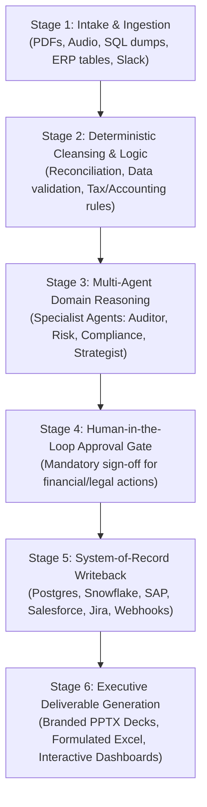
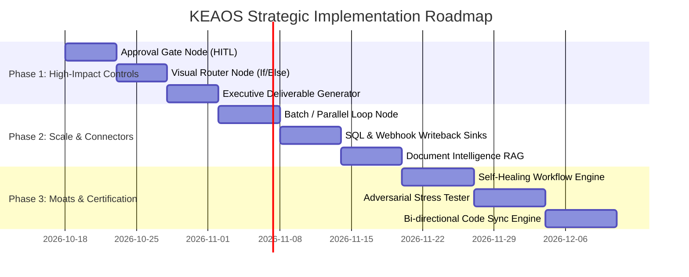

# WayForward1.md — KEAOS Enterprise Agent Operating Studio
## Strategic Vision, Competitive Benchmark, Missing Architectural Components & Implementation Roadmap

---

## 1. Executive Vision: The "Zero-Code to Full-Code" Agentic Operating Studio

### The Core Objective
The mission of **KEAOS (Enterprise Agent Operating Studio)** is to enable anyone—from senior strategy consultants and enterprise architects to software engineers—to build, test, audit, evaluate, and deploy **any real-world software product or business automation agentically** without being restricted by traditional coding environments.

**The Golden Rule**: *Anything that can be written in Python, SQL, or JavaScript should be capable of being constructed, orchestrated, visually audited, and executed within KEAOS in real time.*

### Why Existing Solutions Fall Short
- **Toy AI builders** (e.g., standard prompt chain wrappers) hallucinate frequently, have no deterministic logic, lack compliance controls, and fail when subjected to real-world enterprise edge cases.
- **Developer-only code frameworks** (e.g., raw LangGraph, AutoGen) are powerful, but lock out business analysts, management consultants, and executive decision-makers because they have no visual mental model or verifiable audit trail.
- **Enterprise legacy software suites** are rigid, prohibitively expensive, and vendor-locked.

**KEAOS bridges this chasm** by providing a visual, strictly-typed canvas backed by real 0-token deterministic engines, live multi-LLM orchestration, cryptographic SHA-256 ledgers, and exportability into industry-standard SDKs.

---

## 2. Current Architectural Baseline (What We Already Have)

KEAOS already possesses foundational pillars that put it ahead of standard market tools:

1. **The 10 Segregated Architectural Pillars**: Clean division between Model, Skills, MCP, Tools, Gateway, Memory, Policies, Cryptographic Audit, Observability, and Cost-Benefit ROI.
2. **Deterministic 0-Token Logic Boxes**: Running real Python, SQL, and JavaScript math, joins, table pivots, and VLOOKUPs without wasting tokens or introducing LLM hallucinations.
3. **Multi-Model Inference Engine**: Real-time direct connections to Google GenAI, Anthropic Claude, OpenAI, Ollama (local/private hardware), and OpenRouter (200+ models).
4. **Universal MCP (Model Context Protocol)**: Live integrations with Outlook, Slack, Jira, GitHub, Neo4j, and custom JSON-RPC/SSE servers.
5. **W3C WebCrypto SHA-256 Audit Ledger**: Immutable, tamper-evident cryptographic fingerprinting of all inputs, prompts, outputs, and intermediate states.
6. **Multi-SDK Code Synthesis**: Visual graphs export directly into idiomatic Python for Google ADK, LangGraph, AutoGen, CrewAI, and LangChain.
7. **Showroom Studio**: Generative frontend rendering engine to preview interactive micro-applications and visual client outputs.
8. **Golden Dataset Alignment Gate**: Automated LLM-as-a-judge benchmarking against ground truth datasets to block unsafe or inaccurate agent releases.

---

## 3. Global Competitive Benchmark

To build an institutional-grade, venture-ready platform, KEAOS is benchmarked against the leading agentic and automation systems worldwide:

| Platform / Framework | Core Strengths | Fatal Flaws & Blindspots | KEAOS Advantage & Differentiation |
| :--- | :--- | :--- | :--- |
| **Palantir AIP** | • Enterprise digital twin ontology • Direct ERP/database action writeback • Strict governance & branching | • Extremely expensive ($1M+ minimums) • Proprietary lock-in • Monolithic deployment & steep learning curve | • Lightweight, open-source compatible • Native Model Context Protocol (MCP) • Instant deployment with zero vendor lock-in |
| **LangGraph / CrewAI** | • Cyclic graphs & state persistence • Fine-grained Python control • Hierarchical agent delegation | • Code-only; high barrier to entry • No native UI for business stakeholders • Difficult to visually audit data flows | • Visual canvas paired with 1-click code export • Visual live execution traces • Accessible to consultants & domain experts |
| **Dify.ai / Coze** | • Rapid chatbot building • Out-of-the-box RAG pipelines • Easy web publishing | • Monolithic, rigid prompt pipelines • No 0-token deterministic math/code boxes • Weak multi-agent coordination & governance | • 10 segregated pillars • Deterministic code execution engine • Cryptographic tamper-proof auditing |
| **n8n / Make** | • 400+ SaaS API integrations • Robust conditional branching (`If/Else`) • Reliable cron and webhook triggers | • Weak cognitive reasoning • Treats AI as a single dumb API node • No agent memory, reflection, or guardrails | • True cognitive agent cores • Native multi-LLM reasoning • Enterprise guardrails & policy enforcement |
| **Claude Code / Cursor** | • Autonomous multi-step tool loops • Local terminal execution & file search • Autonomous error self-correction | • Limited to developer command lines • No institutional compliance visualizer • Cannot generate executive presentations | • Combines autonomous tool loops with executive presentation and audit views |

---

## 4. The End-to-End Enterprise Consulting & Advisory Workflow

High-ticket consulting and advisory projects follow a strict 6-stage operational pipeline:

1. **Stage 1: Multi-Modal Ingestion**: Ingesting messy client data (thousands of scanned invoices, earnings calls audio, ERP tables, contracts).
2. **Stage 2: Deterministic Data Cleansing**: 100% mathematical accuracy for accounting calculations, table joins, and validation without LLM hallucinations.
3. **Stage 3: Specialist Multi-Agent Reasoning**: Coordinated execution between domain agents (e.g., Tax Specialist + Risk Auditor + Executive Summarizer).
4. **Stage 4: Human-in-the-Loop Governance Gate**: Preventing catastrophic autonomous actions (e.g., signing off on payments, emailing clients, writing to production databases).
5. **Stage 5: Production System Writeback**: Automatically committing verified outputs into corporate enterprise systems (Postgres, SAP, Snowflake, Jira, Salesforce).
6. **Stage 6: Polished Deliverables**: Delivering executive artifacts (PowerPoint decks, Excel models with live formulas, and interactive portals).

---

## 5. The 6 Missing Strategic Components (Detailed Specifications)

To close the final 20–25% capability gap and allow **any software application** to be built agentically, the following 6 components will be added:

---

### Component 1: Human-in-the-Loop (HITL) & Approval Gate Node
* **Why It Is Essential**: In legal, healthcare, tax, and corporate finance, an autonomous agent must NEVER commit high-risk actions without explicit human authorization.
* **Component Specification**:
  - **Node Type**: `approvalNode` / `Approval Gate`
  - **Color**: `#EAAA00` (Amber Governance)
  - **Behavior**:
    - When execution reaches this node, the workflow suspends execution state.
    - Generates an **Action Preview Card** displaying:
      1. What action the agent wants to take (e.g., *"Transfer $45,000 to Supplier Acme Corp"* or *"Publish Report to Client Portal"*).
      2. The supporting reasoning and evidence extracted by the agent.
      3. A JSON / Form diff of the payload.
    - Interactive controls: **[Approve & Continue]**, **[Reject & Terminate]**, **[Edit Payload & Proceed]**.
    - Integrations: Triggers email or Slack notifications with 1-click approval webhooks for asynchronous sign-offs.

---

### Component 2: Visual Conditional Router / Switch Node (`If / Else / Switch`)
* **Why It Is Essential**: Complex real-world workflows fork based on data criteria. Non-technical users need to visually inspect and modify decision paths without editing Python scripts.
* **Component Specification**:
  - **Node Type**: `routerNode` / `Conditional Router`
  - **Color**: `#0091DA` (Pacific Blue)
  - **Behavior**:
    - Evaluates incoming payloads against user-defined rules.
    - Multiple dynamic output sockets:
      - `Port A (Condition 1)`: e.g., `payload.riskScore > 0.75` $\rightarrow$ Routes to Escalation Agent.
      - `Port B (Condition 2)`: e.g., `payload.department == 'Finance'` $\rightarrow$ Routes to Accounting Agent.
      - `Port Default (Fallback)`: Standard processing pipeline.
    - Supports both visual point-and-click dropdown rules and custom JavaScript/Python expression evaluation.

---

### Component 3: Batch & Parallel Loop Node (`For-Each & Scatter-Gather`)
* **Why It Is Essential**: Real projects don't process one document at a time. Enterprises need to run 500 contracts through an analysis pipeline simultaneously and consolidate results.
* **Component Specification**:
  - **Node Type**: `batchNode` / `Parallel Scatter-Gather`
  - **Color**: `#6D2077` (Magenta)
  - **Behavior**:
    - **Scatter**: Takes an array of items (e.g., list of PDF files, customer rows, or ticket IDs) and splits them into concurrent sub-tasks.
    - **Worker Pipeline**: Runs the connected agent or deterministic node concurrently with configurable concurrency limits (e.g., 5 parallel threads to prevent API rate limits).
    - **Gather**: Collects all completed sub-agent outputs, aggregates them into a unified table/JSON dataset, and forwards them to the downstream node.

---

### Component 4: System-of-Record Writeback Sinks (Database & API)
* **Why It Is Essential**: Today's `OutputDisplayNode` renders markdown or offers file downloads. Full-fledged products must directly persist data to enterprise databases and services.
* **Component Specification**:
  - **Node Types**:
    1. **SQL Database Sink**: Direct parameterized read/write connections to PostgreSQL, MySQL, Supabase, and Snowflake.
    2. **REST / GraphQL Webhook Sink**: Configurable HTTP POST/PUT/PATCH with custom bearer tokens, headers, and request retry strategies.
    3. **Cloud Storage Sink**: Direct uploads to AWS S3, Google Cloud Storage, or Azure Blob.
  - **Security**: Parameterized queries to eliminate SQL injection; zero credentials stored in plain text.

---

### Component 5: Document Intelligence & Hybrid Knowledge RAG Pipeline
* **Why It Is Essential**: Enterprise RAG requires more than simple text chunking. It requires parsing complex financial tables, scanned PDFs, and providing exact source citations.
* **Component Specification**:
  - **Node Type**: `knowledgeNode` / `Document Intelligence RAG`
  - **Color**: `#483698` (Violet Memory)
  - **Behavior**:
    - Multi-format parser: OCR for scanned PDFs, layout-aware table extraction for Excel/DOCX.
    - Chunking strategies: Semantic chunking, sliding window, and header-based partitioning.
    - Hybrid Search: Combined BM25 lexical keyword matching + dense vector embeddings + Neo4j knowledge graph relations.
    - Grounded Citations: Every generated claim links back to exact page numbers, paragraph coordinates, and document IDs.

---

### Component 6: Executive Deliverable Generator (PPTX, Formulated Excel, Reports)
* **Why It Is Essential**: High-value deliverables are not raw chat outputs. Clients pay for structured slide decks, financial workbooks with active formulas, and interactive dashboards.
* **Component Specification**:
  - **Node Type**: `deliverableNode` / `Executive Deliverable Generator`
  - **Color**: `#009A44` (Enterprise Green)
  - **Output Formats**:
    1. **PowerPoint (`.pptx`)**: Generates branded presentation slides with titles, bullet points, KPI cards, and two-column layouts.
    2. **Excel (`.xlsx`)**: Generates multi-tab workbooks containing **live formulas** (`SUM`, `VLOOKUP`, `IRR`, percentage variances), styled header bands, and number formatting.
    3. **PDF / CommonMark Dossiers**: Print-ready executive memorandums with tables of contents, callouts, and institutional headers.
    4. **Showroom Micro-App**: Deploys an interactive client-facing portal using the KEAOS Showroom engine.

---

## 6. The 4 "Secret Sauce" Moats (Differentiating KEAOS from the World)

To ensure this platform is uniquely compelling for commercial ventures, it incorporates 4 high-impact differentiating capabilities:

### A. The "Self-Healing Workflow" (Autonomous Error Recovery)
* **How It Works**:
  - If a downstream API changes its schema, or if a Python script in a Deterministic Box encounters a runtime exception:
  - An integrated **Self-Correction Monitor** intercepts the error stack trace, compares the expected input against the received payload, automatically modifies the transformation script or sanitizes the prompt, and retries execution.
  - The workflow self-heals in real time without crashing, logging a transparent audit entry: `[Self-Healed: Schema Mismatch Auto-Resolved]`.

### B. The "What-If" Digital Twin & Adversarial Stress Tester
* **How It Works**:
  - Before an enterprise deploys an agent to handle live transactions or customers, one click triggers an **Adversarial Stress Test**.
  - A synthetic "Red Team Agent" fires 50 difficult scenarios at the workflow (jailbreaks, corrupted currency inputs, ambiguous prompts, negative numbers, missing fields).
  - KEAOS produces a **Resilience & Alignment Score (e.g., 96/100)** with a granular breakdown of any failing nodes before production release.

### C. Bi-Directional Visual Canvas $\leftrightarrow$ Pure Code Sync
* **How It Works**:
  - Visual dragging, adding nodes, and configuring parameters instantly updates clean, production-grade Python/TypeScript code.
  - Software engineers can edit the raw Python code directly in the code editor, and the visual canvas updates its node topology in real time.
  - Eliminates the division between business consultants and software engineering teams.

### D. Cryptographic Certificate of Execution
* **How It Works**:
  - Every run generates a downloadable, verifiable **Institutional Certificate of Audit**.
  - Contains SHA-256 hashes of input transcripts, prompt templates, deterministic rules, model responses, and human approval timestamps.
  - Serves as non-repudiable legal proof for auditors, regulators, and compliance committees.

---

## 7. Phased Implementation Roadmap

This backlog establishes the sequence for incremental, one-by-one implementation:

### Phase 1: Immediate High-Impact Controls (Foundation)
- [x] **Item 1.1: Human-in-the-Loop (HITL) Approval Gate Node**
  - Added `ApprovalNode` to canvas with soft-curved, subtle capsule token geometry and in-place 3-tab review popover.
  - Implemented dual 3rd-option architecture:
    - **Flavor A (Direct Edit & Proceed)**: Reviewer directly edits the payload (0 tokens) and releases it downstream without re-prompting.
    - **Flavor B (Steer & Refine)**: Reviewer enters steering guidance; dispatches `keaos:steer-agent` to loop back and re-prompt upstream agent.
  - Implemented `ApprovalInspectorPanel` with Reviewer Roles, Governance policies (Allow Override, Allow Steering, Timeout Action), and Decision Simulator.
  - Placed under new `Governance` section in the right panel.
- [x] **Item 1.2: Visual Conditional Router Node (`If / Else / Switch`)**
  - Added `RouterNode` with subtle capsule styling, `true-out` and `false-out` dual ports.
  - Implemented `routerEngine.js` for pure condition rule evaluation.
  - Placed under new `Logics` section in the right panel.
- [ ] **Item 1.3: Executive Deliverables Generator (Excel & Presentation)**
  - Integrate native `.xlsx` generation with live mathematical formulas.
  - Integrate native `.pptx` generation with executive slide themes.

### Phase 2: Enterprise Scale & Writeback Sinks
- [ ] **Item 2.1: Batch & Parallel Loop Node (`Scatter-Gather`)**
  - Array partitioning, concurrent worker execution, and result aggregation.
- [ ] **Item 2.2: System-of-Record Writeback Sinks**
  - Postgres/SQL connection sink and universal HTTP/REST webhook sink.
- [ ] **Item 2.3: Document Intelligence & Citations Engine**
  - OCR table extraction and grounded citation coordinates.

### Phase 3: Differentiating Moats & Certifications
- [ ] **Item 3.1: Self-Healing Workflow Engine**
  - Automated diagnostic interceptor and code patch generator for Deterministic Boxes.
- [ ] **Item 3.2: Adversarial "What-If" Stress Tester**
  - Red-teaming test harness with 50 automated edge-case evaluations.
- [ ] **Item 3.3: Cryptographic Certificate Generator**
  - 1-click printable & verifiable PDF/JSON compliance certificate with SHA-256 signatures.

---

*This document serves as the master specification and living backlog for KEAOS. All subsequent engineering tasks will pull directly from these prioritized specifications.*
